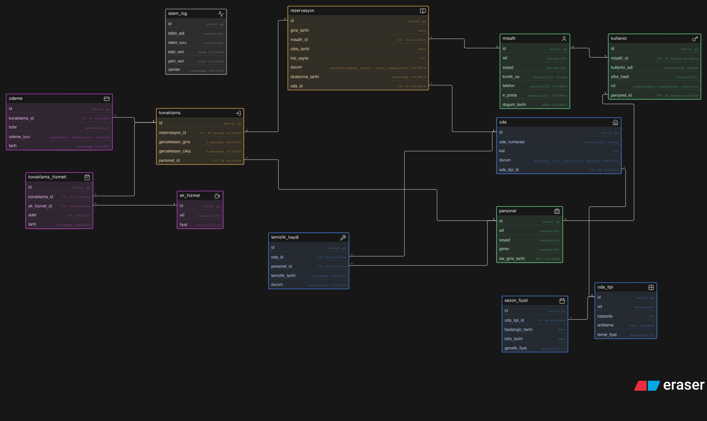

# Otel Rezervasyon Projesi 

🌍 **Dil / Language:** [Türkçe](#-proje-amacı) | [English](#-project-purpose)

---

## 🎯 Proje Amacı
Bu proje, Veritabanı ve Yönetimi dersi kapsamında geliştirilmiş bir arka yüz (backend) ve veritabanı modelleme çalışmasıdır. Projenin temel amacı; ilişkisel veritabanı mimarisini standartlara uygun biçimde tasarlamak, tablolar arası ilişkileri kurgulamak ve bu veri yapısını TypeScript tabanlı modern bir RESTful API aracılığıyla yönetilebilir hale getirmektir.

Depo içerisinde yer alan şema ve dokümantasyonlar (`Tables.md`, `dbDiagram.svg`) aracılığıyla veri modeli görselleştirilmiş ve detaylandırılmıştır. Node.js ve Express.js altyapısı üzerine inşa edilen uygulama katmanı, veritabanı tasarımının iş kuralları ve veri operasyonlarıyla nasıl entegre edileceğini somutlaştırmaktadır.

## 🛠️ Kullanılan Teknolojiler
* **Çalışma Zamanı (Runtime):** Node.js
* **Programlama Dili:** TypeScript
* **Web Framework:** Express.js (v5.x)
* **Geliştirme Araçları:** Nodemon, ts-node, ts-node-dev
* **Veritabanı Tasarım ve Dokümantasyon:** dbDiagram (SVG ERD), Markdown şema dokümantasyonu

## 🚀 Kurulum ve Çalıştırma

Projeyi yerel ortamınızda ayağa kaldırmak için aşağıdaki adımları sırasıyla uygulayabilirsiniz:

```bash
# 1. Depoyu klonlayın
git clone https://github.com/Merenylmz/DatabaseAndManagementHomework.git

# 2. Proje dizinine gidin
cd DatabaseAndManagementHomework

# 3. Gerekli bağımlılıkları yükleyin
npm install

# 4. Ortam değişkenlerini yapılandırın (.example.env dosyasından kopyalayarak)
cp .example.env .env

# 5. Geliştirme (development) modunda başlatın
npm run dev

# 6. Üretim (production) derlemesi almak ve çalıştırmak için:
npm run build
npm start
```

## 📌 Ek Bilgiler ve Özellikler
* **Veritabanı Modelleme Şeması:** Proje kök dizininde bulunan `dbDiagram.svg` ve `Tables.md` dosyaları, sistemde tanımlanan varlıkları (entities), birincil/yabancı anahtar (PK/FK) ilişkilerini ve tablo alan tiplerini ayrıntılı olarak belgeler.
* **Modern Express & TypeScript Yapısı:** Proje, Express'in en güncel 5.x sürümü ve katı tip denetimi sağlayan TypeScript konfigürasyonu ile yapılandırılmıştır.
* **Ortam Değişkenleri Yönetimi:** Güvenlik ve yapılandırma yönetimi için `.example.env` şablonu dahil edilmiştir.

<small>Proje, .vscode klasörünü ve settings.json/ -->"prisma.pinToPrisma6": true ayarını gerektirebilir.</small>

---

# Hotel Rezervation Project (English)

## 🎯 Project Purpose
This project is an academic and practical implementation developed for a Database and Management coursework. The primary goal is to architect a normalized relational database schema, define entity relationships, and provide a manageable interface for these data structures using a modern TypeScript-based REST API.

The data models and relational schemas are documented and visualized through `Tables.md` and `dbDiagram.svg`. Built on top of Node.js and Express.js, the application layer demonstrates the integration between database design, business logic, and backend data operations.

## 🛠️ Technologies Used
* **Runtime:** Node.js
* **Programming Language:** TypeScript
* **Web Framework:** Express.js (v5.x)
* **Development Tooling:** Nodemon, ts-node, ts-node-dev
* **Database Design & Documentation:** dbDiagram (SVG ERD), Markdown Schema Specs

## 🚀 Installation and Usage

Follow these steps to set up and run the project locally:

```bash
# 1. Clone the repository
git clone https://github.com/Merenylmz/DatabaseAndManagementHomework.git

# 2. Navigate to the project directory
cd DatabaseAndManagementHomework

# 3. Install dependencies
npm install

# 4. Configure environment variables (copy from .example.env)
cp .example.env .env

# 5. Run the application in development mode
npm run dev

# 6. Build and run in production mode:
npm run build
npm start
```

## 📌 Additional Information & Features
* **Database Architectural Design:** Includes `dbDiagram.svg` and `Tables.md` files at the root level, documenting entity attributes, primary/foreign key mappings, and table relations.
* **Modern TypeScript & Express Stack:** Leverages the latest Express 5.x along with strong typing via TypeScript for reliable and maintainable code execution.
* **Environment Configuration:** Pre-configured with `.example.env` for safe and reproducible environment setup.

<small>The Project may require a .vscode folder and the setting in settings.json/ -->"prisma.pinToPrisma6": true</small>

## Proje Veritabanı Tasarımı / Project Database Design
